# Lantai (兰台)

> Official repository: <https://github.com/punk64/Lantai>
>
> 中文文档：[README.md](README.md)

**Lantai is a custom distribution of [Komga](https://github.com/gotson/komga).** Built on Komga 1.29.2, it keeps the upstream data model, scanner, page streaming and client protocols, replaces the web frontend, and adds ebook formats, online sources, metadata scraping, reading statistics, full-text search and text-to-speech.

> This is not an official Komga project and is not affiliated with gotson/komga or its author.
> The original project is copyright Gauthier Roebroeck, licensed under MIT.

The name comes from *Lantai* (兰台), the imperial library and archive of Han-dynasty China — established in the Western Han (202 BC – AD 8) at Chang'an, continued through the Eastern Han (AD 25–220), where Ban Gu once served as Lantai ling-shi. The relationship with Komga in one phrase: **same origin, different road**.

## Release status

**Every release before V1.0.0 is a test build.** Feature updates during this period aim to avoid breaking the existing data structures; the focus is on interface fixes and experience improvements. Any breaking change across versions will be documented separately with a migration path.

## Relationship with Komga

| Item | Detail |
|---|---|
| This repository | [punk64/Lantai](https://github.com/punk64/Lantai) |
| Upstream | [gotson/komga](https://github.com/gotson/komga), MIT |
| Baseline | 1.29.2 (tag `1.29.2`, commit `829f7588`, 2026-10-28) |
| Forked on | 2026-10-30 |
| Upstream sync | **Ended on 2026-10-31.** Package names, config prefixes, module layout and class names have all been renamed; upstream merges are no longer possible |
| Inherited from Komga | Library / series / book model, file scanning and metadata parsing, page streaming and thumbnails, OPDS v1/v2, Kobo Sync, KOReader Sync, WebPub, permissions and multi-user |
| Added or rewritten by Lantai | Web frontend (dependency-free), EPUB / TXT readers, online sources (bundled Suwayomi), Douban / AniList scraping, reading-time statistics, annotations and bookmarks, in-book full-text search, sentence-level TTS highlighting, 39 UI languages, instant-open loading model |
| Full diff against upstream | see `FORK_BASE.md` |

## Capabilities

| Area | Details |
|---|---|
| Formats | CBZ / CBR / CB7 / PDF / EPUB / TXT, read directly |
| Readers | Comic page flow (double page, webtoon, reading direction); ebook dual mode (scroll / paged) preserving original typesetting, with adjustable font, size, line height and theme |
| Reading aids | Sentence-level TTS with highlighting, in-book full-text search, annotations and bookmarks |
| Online sources | Bundled Suwayomi, no client extension needed; subscribe, browse, download single chapters to the archive without losing progress |
| Metadata | Douban Books + AniList search and matching, field-by-field conflict review; the scrape list exports to JSON / CSV for external filling and re-import, or external programs can submit through a scrape token |
| Statistics | Reading-time detail plus daily aggregation, fed by both web heartbeat and client reports |
| Protocols | OPDS v1 / v2, Kobo Sync, KOReader Sync, WebPub |
| Accounts | Multi-user, role permissions, sub-accounts, one-time password reset |
| Interface | 39 languages, Simplified Chinese by default |

## Screenshots

The screenshots below come from an **actual Lantai `0.4.21` instance**, not a mockup: a separate instance with invented test books — titles, authors and statistics are all demo data, and library paths are redacted. The left column is the "Xuan" light theme, the right column the "Mojin" dark theme; the sun / moon button in the top bar switches between them instantly.

| Page | Xuan (light) | Mojin (dark) |
|---|---|---|
| Home | 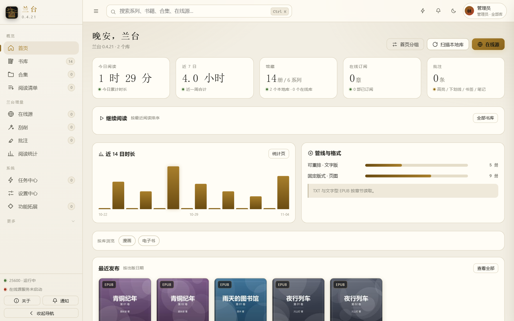 | 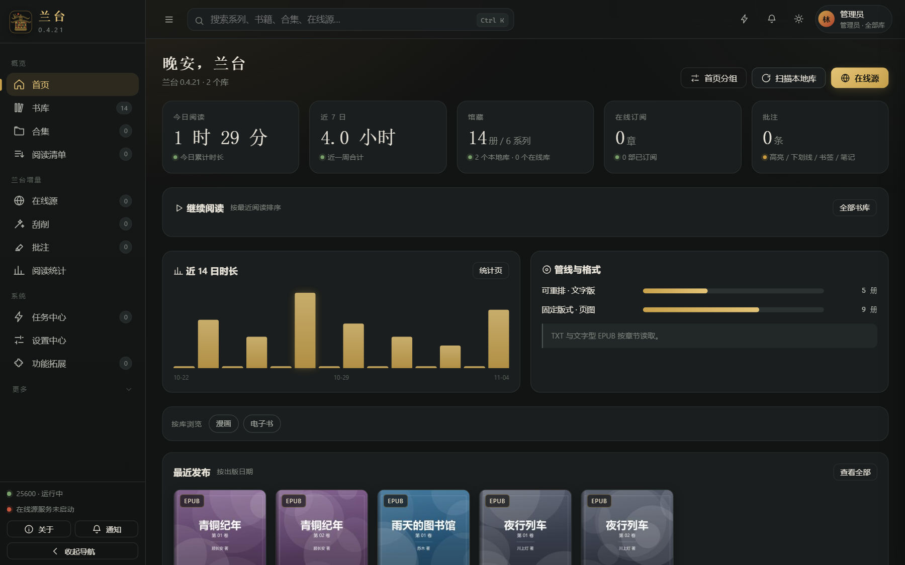 |
| Library | 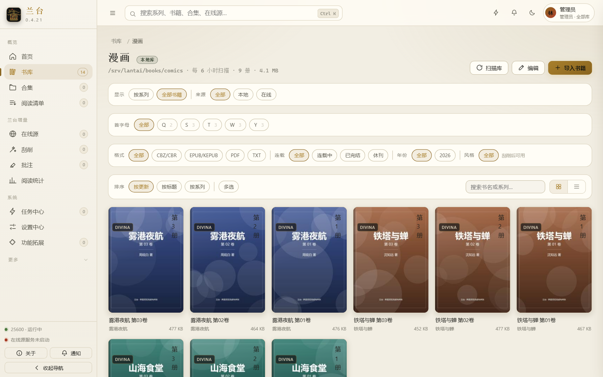 | 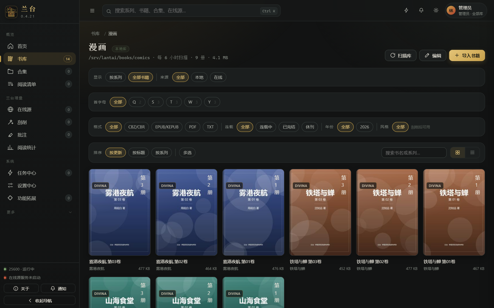 |
| Series detail | 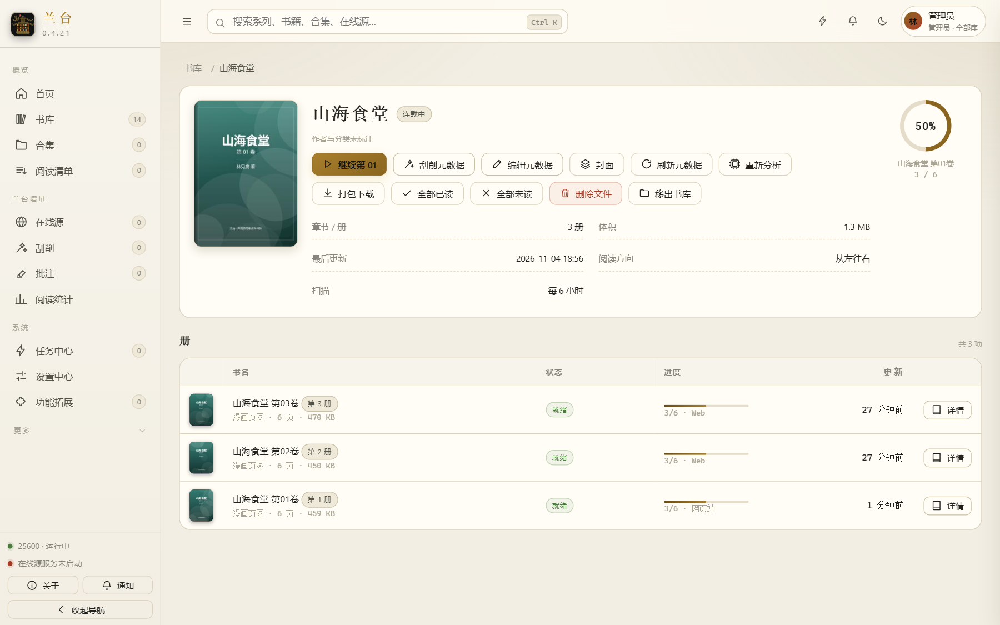 | 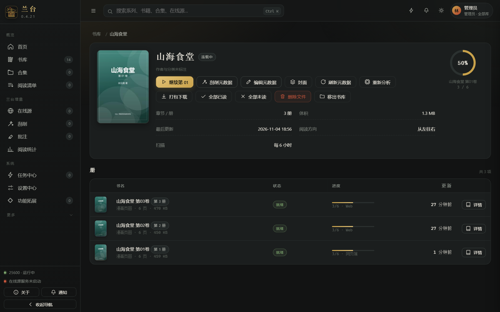 |
| Reader | 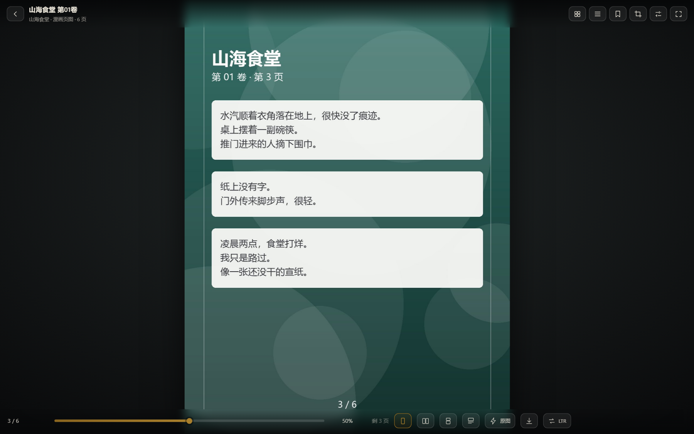 | 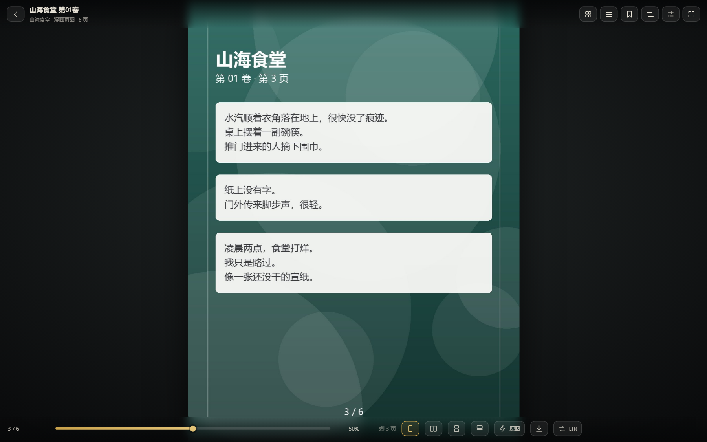 |
| Reading stats | 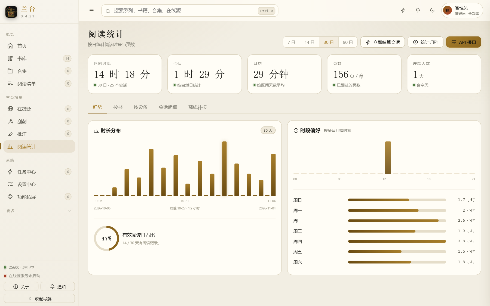 | 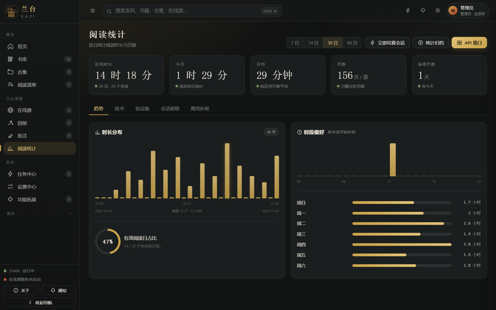 |
| Settings | 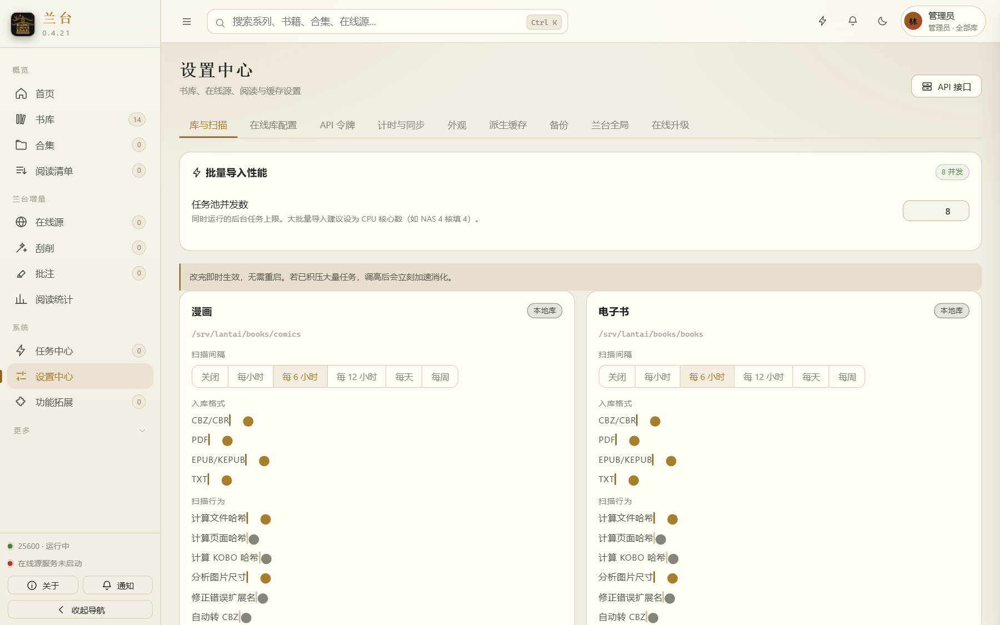 | 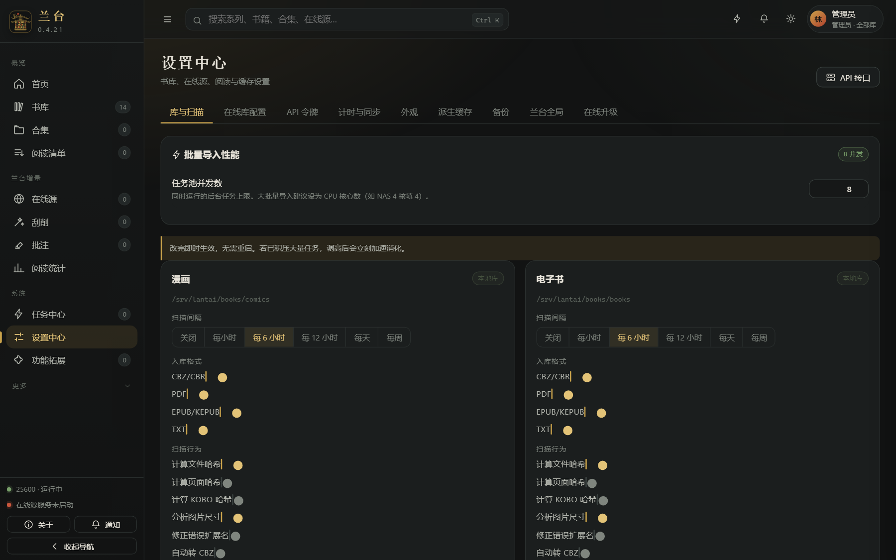 |

## Languages

39 languages, Simplified Chinese by default. Switch instantly under *Settings → Appearance*, no restart needed.

| Language | Code | Language | Code | Language | Code |
|---|---|---|---|---|---|
| Simplified Chinese | `zh-Hans` | Traditional Chinese | `zh-Hant` | English | `en` |
| Japanese | `ja` | Korean | `ko` | Russian | `ru` |
| German | `de` | French | `fr` | Spanish | `es` |
| Portuguese | `pt` | Portuguese (Brazil) | `pt-BR` | Italian | `it` |
| Dutch | `nl` | Polish | `pl` | Czech | `cs` |
| Slovak | `sk` | Slovenian | `sl` | Croatian | `hr` |
| Bulgarian | `bg` | Ukrainian | `uk` | Swedish | `sv` |
| Danish | `da` | Norwegian | `nb` | Finnish | `fi` |
| Catalan | `ca` | Galician | `gl` | Arabic | `ar` |
| Hebrew | `he` | Persian | `fa` | Turkish | `tr` |
| Greek | `el` | Hungarian | `hu` | Indonesian | `id` |
| Vietnamese | `vi` | Thai | `th` | Tamil | `ta` |
| Malayalam | `ml` | Tigrinya | `ti` | Esperanto | `eo` |

Simplified Chinese ships in the main bundle; the other 38 load on demand, fetched only when selected.

## Tech stack

Kotlin · Spring Boot 3.5 · Spring Data JDBC + jOOQ · Flyway · SQLite · Lucene · Gradle 9 · JDK 21

## Layout

```
lantai/                  Spring Boot backend (API, scanner, client protocols)
lantai/docker/           Image build files and both compose files
lantai-webui-v2/         Web frontend source (dependency-free vanilla JS)
docs/preview/            Screenshots
res/                     Application icons
gradle/                  Gradle wrapper
```

The frontend uses no framework and no npm packages; the build script is `lantai-webui-v2/build.js` inside the repo.

## Requirements

| Item | Version | Purpose | Notes |
|---|---|---|---|
| JDK | **21** | Build and run | Hard requirement; older versions fail to compile |
| Node.js | **22** | Frontend build only | Dependency-free, no `npm install` |
| Gradle | Bundled wrapper | Build | No separate install; `gradlew` downloads the right version |
| Memory | 2 GB+ for builds | — | `org.gradle.jvmargs=-Xmx2G` |
| Disk | ~2 GB for source and dependencies | — | First build downloads Gradle and Maven artifacts |

If Java or Node are not on `PATH`, set the environment first:

```bash
export JAVA_HOME=/path/to/jdk-21
export PATH="$JAVA_HOME/bin:$PATH"
```

## Building a working package from source

```bash
git clone https://github.com/punk64/Lantai.git
cd Lantai

cd lantai-webui-v2 && node build.js && cd ..

./gradlew :lantai:lantaiuiCopyIndex :lantai:bootJar -x test
```

Output:

```
lantai/build/libs/lantai-<version>.jar
```

**`lantaiuiCopyIndex` is not optional.** It copies `lantai-webui-v2/dist/` into `lantai/src/main/resources/public/` and generates `index-lantai.html` with the Thymeleaf tags. Running `bootJar` alone produces a jar with no frontend, or with the previous build's frontend, and the home page will not open.

Before copying, it removes the previous `js/lantai.*.js`, `css/lantai.*.css` and `index-lantai.html` from `public/`, so no stale hashed files accumulate.

`-x test` skips unit tests. The suite contains several long-standing failures; without the flag the build stops.

## Running and deploying

```bash
java -jar lantai/build/libs/lantai-<version>.jar --lantai.config-dir=/srv/lantai
```

| Item | Default | Notes |
|---|---|---|
| Port | `25600` | Change with `--server.port=8080` |
| Data directory | `~/.lantai` | Strongly recommended to set `--lantai.config-dir` explicitly |
| URL | `http://localhost:25600` | — |

The data directory will contain:

```
database.sqlite      libraries, series, books, users and metadata
tasks.sqlite         background task queue and history
sessions.sqlite      login sessions
lucene/              full-text search index
fonts/               uploaded custom fonts
logs/                runtime logs, including lantai.log and extensions.log
```

**Never delete the data directory when upgrading** — everything lives there.

### First start

When the database contains no users, startup generates a random administrator account, **printed exactly once** to both the console and `logs/lantai.log`:

```
============================================================
  兰台已生成管理员账号（仅首次启动生成，请立即记录）
  登录名：admin-xxxxxxxx
  密  码：************************
  登录后请尽快在「账户」中修改密码
============================================================
```

Log in, change the password under *Settings → Account*, then create regular users as needed. The account is generated only on the first start and is not printed again on restarts; a forgotten password means editing the database or starting over.

### Start on boot

On Linux with systemd:

```ini
[Unit]
Description=Lantai
After=network.target

[Service]
User=lantai
ExecStart=/usr/bin/java -jar /opt/lantai/lantai-<version>.jar --lantai.config-dir=/srv/lantai
Restart=on-failure

[Install]
WantedBy=multi-user.target
```

On Windows, create a Task Scheduler task triggered "At startup" running `javaw -jar <jar> --lantai.config-dir=<data dir>`.

### Docker

Images are named by version and base system. Both run the same `lantai-<version>.jar`, and the upgrade package is shared:

| Tag | Base image | Size | Difference |
|---|---|---|---|
| `lantai:<version>-alpine` | `eclipse-temurin:21-jre-alpine` | ~531 MB | Slim. JRE, fonts, timezone and image decoders only. **Calibre is unavailable** (no official musl build), so MOBI/AZW3 need an external converter |
| `lantai:<version>-ubuntu` | `ubuntu:26.04` | ~1.09 GB | Full. Adds poppler, kepubify, libjxl / libheif / libwebp and Qt runtime, supporting KEPUB conversion and more image formats |

Build (from the repo root, `context` pointing at the `lantai/` module):

```bash
cd lantai-webui-v2 && node build.js && cd ..
./gradlew :lantai:bootJar -x test
cd lantai
docker build -f docker/Dockerfile.alpine --build-arg VERSION=<version> -t lantai:<version>-alpine ..
docker build -f docker/Dockerfile.lantai --build-arg VERSION=<version> -t lantai:<version>-ubuntu ..
```

Inside the container the data directory is fixed at `/config` (SQLite, Lucene index, avatars, upgrade cache) and the library is mounted at `/books`.

#### Full `docker-compose.full.yml`

Host networking, bundled online sources ready to use; three volumes, with `packages/` holding runtime installers.

```yaml
name: lantai

services:
  lantai:
    image: lantai:${LANTAI_VERSION:-0.5.0}-ubuntu
    build:
      context: ..
      dockerfile: docker/Dockerfile.lantai
      args:
        VERSION: ${LANTAI_VERSION:-0.5.0}
        WITH_KEPUBIFY: "true"
    container_name: lantai
    network_mode: host
    environment:
      TZ: Asia/Shanghai
      SERVER_PORT: ${LANTAI_PORT:-25600}
      JAVA_TOOL_OPTIONS: "-Xmx2g -Djava.net.preferIPv4Stack=true"
      LANTAI_CONFIGDIR: /config
      LANTAI_RUNTIME_AUTO_INSTALL: ""
      LANTAI_RUNTIME_AUTO_ENABLE: "true"
      LANTAI_RUNTIME_SOURCE_MODE: "auto"
      LANTAI_RUNTIME_PACKAGE_DIR: /packages
      LANTAI_RUNTIME_FAIL_FAST: "false"
    volumes:
      - ./config:/config
      - ./books:/books
      - ./packages:/packages
    restart: unless-stopped
    stop_grace_period: 40s
    shm_size: 256m
    mem_limit: 3g
    healthcheck:
      test: ["CMD", "curl", "-fsS", "-o", "/dev/null", "http://127.0.0.1:25600/"]
      interval: 30s
      timeout: 5s
      start_period: 120s
      retries: 3
```

#### Slim `docker-compose.slim.yml`

Bridge network with a port mapping, only the data directory and library mounted, online sources disabled, 1.5 GB memory cap — suited to small machines or purely offline reading.

```yaml
name: lantai

services:
  lantai:
    image: lantai:${LANTAI_VERSION:-0.5.0}-alpine
    build:
      context: ..
      dockerfile: docker/Dockerfile.alpine
      args:
        VERSION: ${LANTAI_VERSION:-0.5.0}
    container_name: lantai
    ports:
      - "${LANTAI_PORT:-25600}:25600"
    environment:
      TZ: Asia/Shanghai
      JAVA_TOOL_OPTIONS: "-Xmx1g -Djava.net.preferIPv4Stack=true"
      LANTAI_CONFIGDIR: /config
      LANTAI_ONLINE_ENABLED: "false"
    volumes:
      - ./config:/config
      - ./books:/books:ro
    restart: unless-stopped
    stop_grace_period: 40s
    mem_limit: 1536m
    healthcheck:
      test: ["CMD", "wget", "-q", "--spider", "http://127.0.0.1:25600/"]
      interval: 30s
      timeout: 5s
      start_period: 90s
      retries: 3
```

```bash
docker compose -f docker-compose.slim.yml up -d
docker compose -f docker-compose.full.yml logs -f lantai
```

The first start still prints the random administrator account to the log. If `./config` is auto-created by Docker it is owned by root; the container runs as root and can write directly. Running as non-root requires a manual `chown`.

## Not in this repository

The following are intentionally excluded:

- Both legacy Komga frontends (Vue 2 and Vite) and all their build output
- The desktop tray application `lantai-tray`
- Local packaging and launch scripts (upgrade package, portable build, `启动兰台.bat`)
- Runtime data `RunData/`

## License

MIT, see `LICENSE`. The original project is copyright Gauthier Roebroeck;
Lantai's derivative parts are also released under MIT, retaining the original copyright notice.
