# 兰台 Lantai

> 官方仓库：<https://github.com/punk64/Lantai>

**兰台是 [Komga](https://github.com/gotson/komga) 的定制发行版。** 在 Komga 1.29.2 的基础上深度定制，保留其数据模型、扫描引擎、页流与客户端协议，替换网页前端，并补上电子书格式、在线图源、元数据刮削、阅读统计、全文搜索与 TTS 朗读。

> 本项目非 Komga 官方项目，与 gotson/komga 及其作者无隶属关系。
> 原项目版权归 Gauthier Roebroeck 所有，依 MIT 协议授权。

名字取自汉代藏书之所「兰台」。与 Komga 的关系用一个词概括：**同源，不同路**。

> English: [README.en.md](README.en.md)

## 版本状态

**V1.0.0 之前均为测试版本。** 期间的功能升级与调整会尽量不破坏已有数据结构，改动重点放在界面修复与使用体验优化；确需跨版本的破坏性变更时会单独说明并提供迁移路径。

## 与 Komga 的关系

| 项 | 说明 |
|---|---|
| 本仓库 | [punk64/Lantai](https://github.com/punk64/Lantai) |
| 上游项目 | [gotson/komga](https://github.com/gotson/komga)，MIT |
| 基线版本 | 1.29.2（tag `1.29.2`，commit `829f7588`，2026-10-28） |
| 分叉日期 | 2026-10-30 |
| 上游同步 | **已于 2026-10-31 终止**。包名、配置前缀、模块目录、类名全部改名，与上游代码偏离，不再 merge |
| 继承自 Komga | 书库/系列/书籍数据模型、文件扫描与元数据解析、页流与缩略图、OPDS v1/v2、Kobo Sync、KOReader Sync、WebPub、权限与多用户体系 |
| 兰台新增或重写 | 网页前端（零依赖自研）、EPUB/TXT 阅读器、在线图源（内置托管 Suwayomi）、豆瓣/AniList 刮削、阅读时长统计、批注与书签、书内全文搜索、TTS 逐句高亮、39 种界面语言、秒开加载模型 |
| 与上游的完整差异 | 见 `FORK_BASE.md` |

## 能力

| 分类 | 内容 |
|---|---|
| 格式 | CBZ / CBR / CB7 / PDF / EPUB / TXT 直读 |
| 阅读器 | 漫画页流（双页、条漫、阅读方向）；电子书双模式（滚动 / 分页），保留原书排版，可调字体字号行距与主题 |
| 阅读增强 | TTS 逐句朗读并高亮、书内全文搜索、批注与书签 |
| 在线图源 | 内置托管 Suwayomi，客户端零扩展；订阅、浏览、单章下载存档且不丢进度 |
| 元数据 | 豆瓣读书 + AniList 搜索匹配，冲突逐字段核对；刮削名单可导出为 JSON / CSV，外部填好后导入回写，也可通过刮削令牌接入外部程序 |
| 统计 | 阅读时长明细 + 日聚合，网页心跳与客户端自报双通道 |
| 协议 | OPDS v1 / v2、Kobo Sync、KOReader Sync、WebPub |
| 账号 | 多用户、角色权限、子账户、一次性密码重置 |
| 界面 | 39 种语言，默认简体中文 |

## 界面预览

以下截图取自 **兰台 `0.4.21` 的实际界面**，而非设计稿：使用独立实例与虚构测试书籍，书名、作者、统计数字均为演示数据，书库路径已脱敏。左列为「宣纸」浅色主题，右列为「墨金」深色主题，可通过顶栏的太阳 / 月亮按钮即时切换。

| 页面 | 宣纸（浅色） | 墨金（深色） |
|---|---|---|
| 首页 | 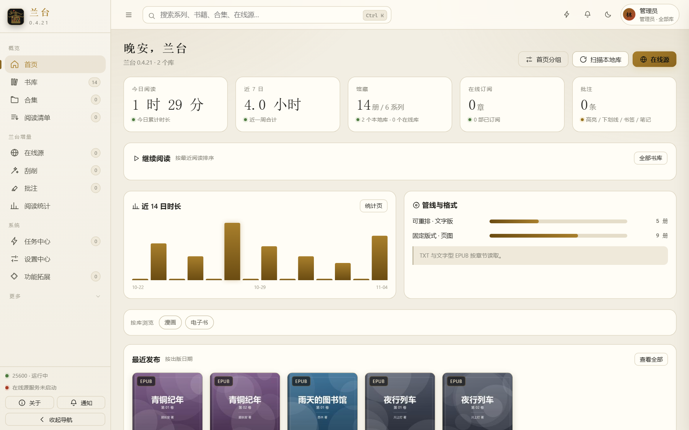 | 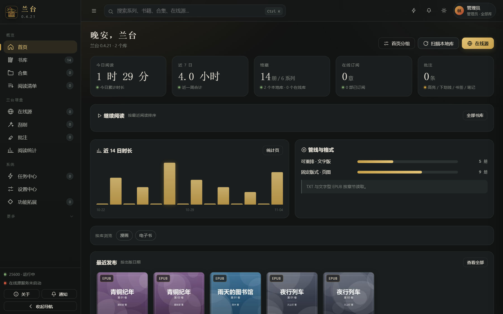 |
| 书库 | 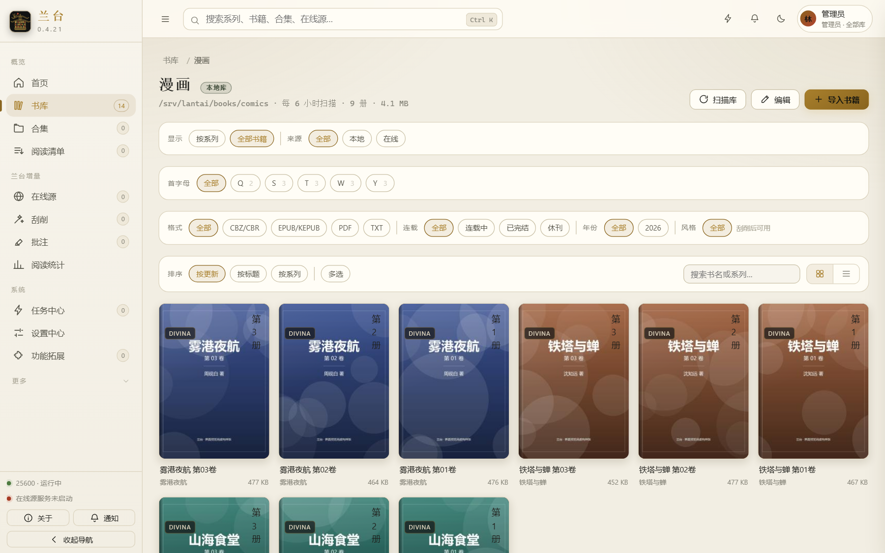 | 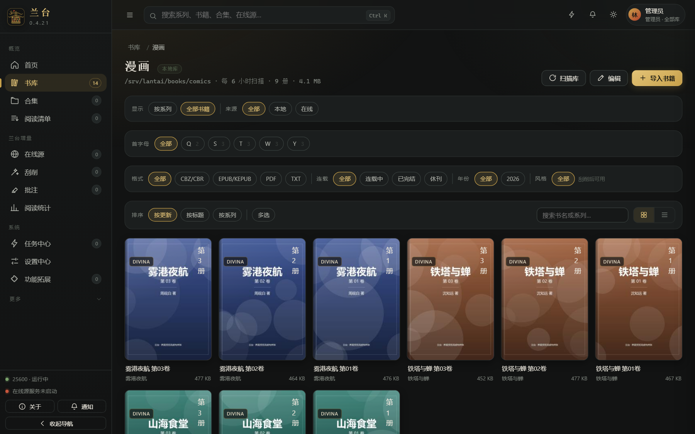 |
| 系列详情 | 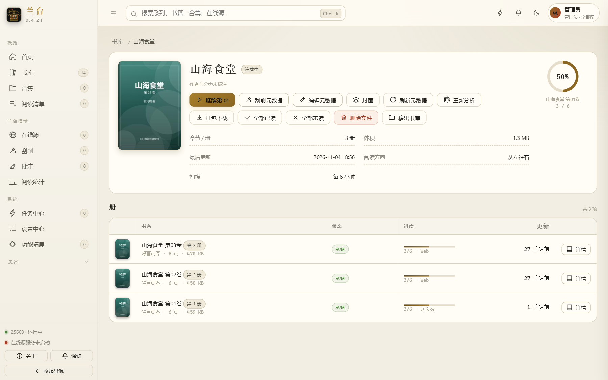 | 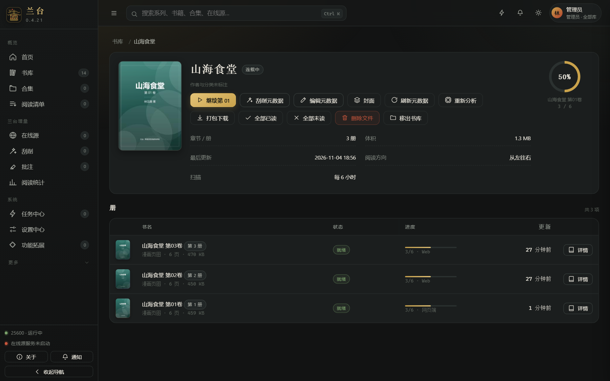 |
| 阅读器 | 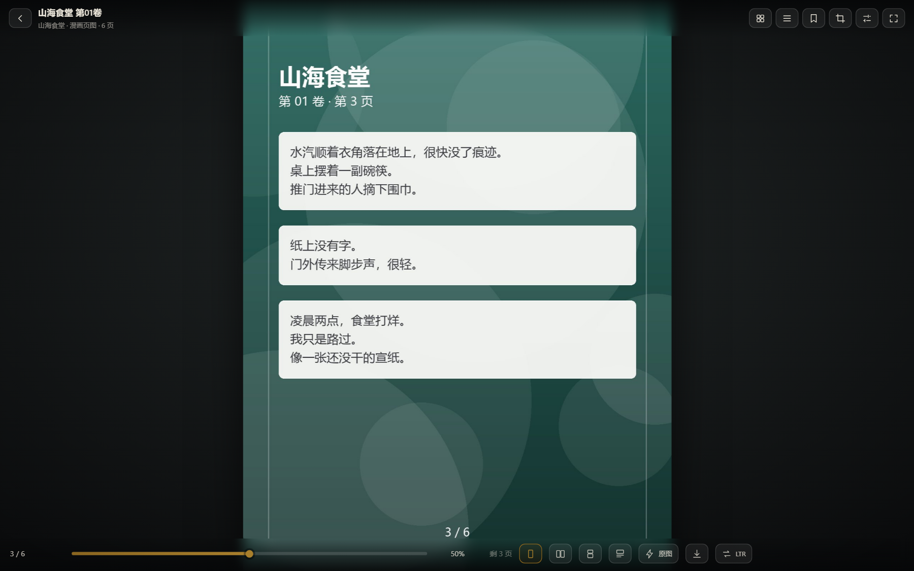 | 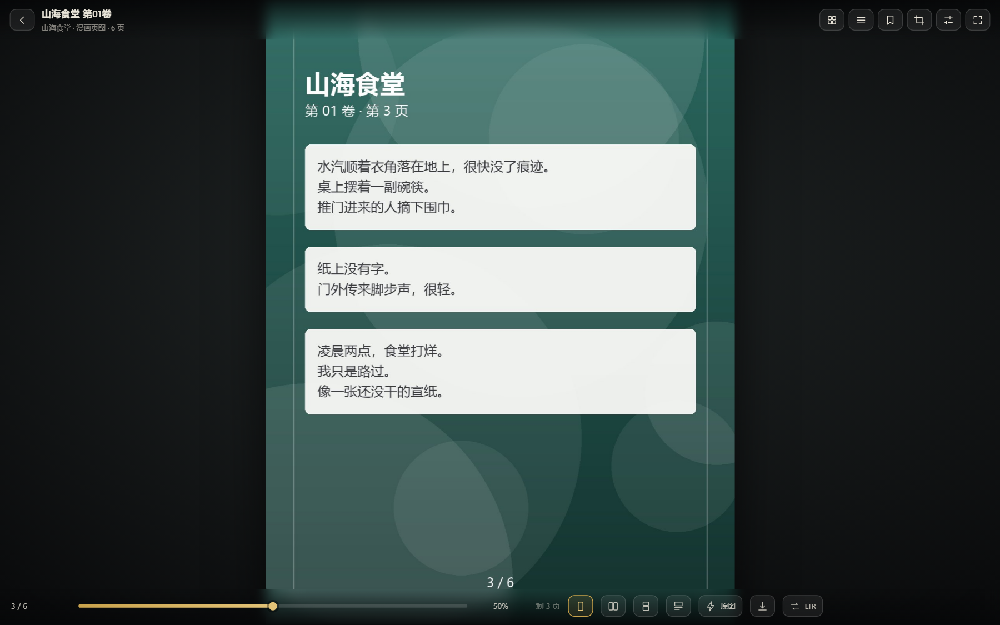 |
| 阅读统计 | 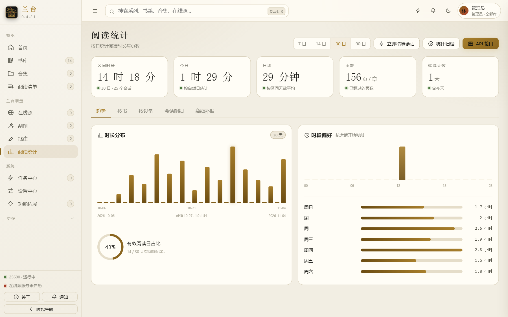 | 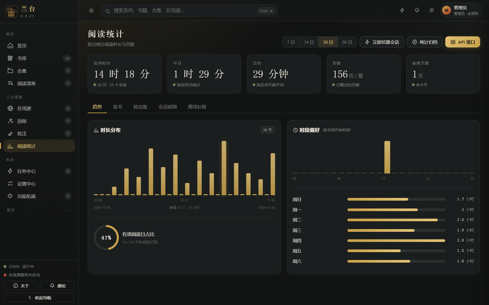 |
| 设置中心 | 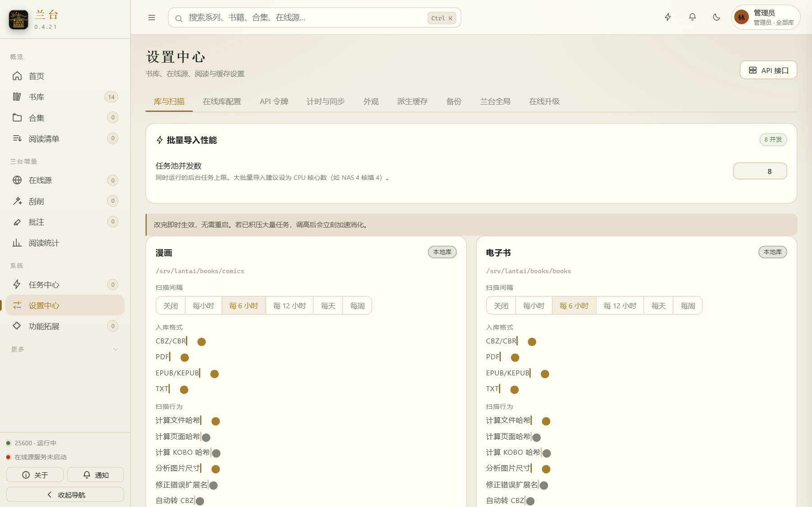 | 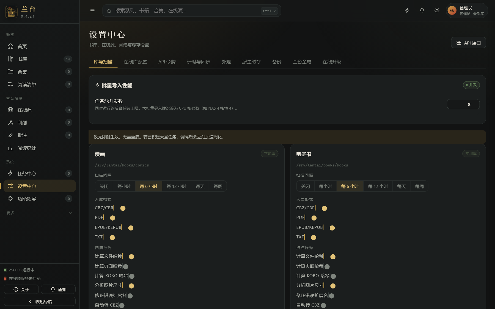 |

## 界面语言

39 种，默认简体中文，可在「设置 → 外观」即时切换，无需重启。

| 语言 | 代码 | 语言 | 代码 | 语言 | 代码 |
|---|---|---|---|---|---|
| 简体中文 | `zh-Hans` | 繁体中文 | `zh-Hant` | 英语 | `en` |
| 日语 | `ja` | 韩语 | `ko` | 俄语 | `ru` |
| 德语 | `de` | 法语 | `fr` | 西班牙语 | `es` |
| 葡萄牙语 | `pt` | 葡萄牙语（巴西） | `pt-BR` | 意大利语 | `it` |
| 荷兰语 | `nl` | 波兰语 | `pl` | 捷克语 | `cs` |
| 斯洛伐克语 | `sk` | 斯洛文尼亚语 | `sl` | 克罗地亚语 | `hr` |
| 保加利亚语 | `bg` | 乌克兰语 | `uk` | 瑞典语 | `sv` |
| 丹麦语 | `da` | 挪威语 | `nb` | 芬兰语 | `fi` |
| 加泰罗尼亚语 | `ca` | 加利西亚语 | `gl` | 阿拉伯语 | `ar` |
| 希伯来语 | `he` | 波斯语 | `fa` | 土耳其语 | `tr` |
| 希腊语 | `el` | 匈牙利语 | `hu` | 印尼语 | `id` |
| 越南语 | `vi` | 泰语 | `th` | 泰米尔语 | `ta` |
| 马拉雅拉姆语 | `ml` | 提格利尼亚语 | `ti` | 世界语 | `eo` |

简体中文内置在主包里，其余 38 种按需加载，切换时才拉取对应语言包。

## 技术栈

Kotlin · Spring Boot 3.5 · Spring Data JDBC + jOOQ · Flyway · SQLite · Lucene · Gradle 9 · JDK 21

## 目录结构

```
lantai/                  Spring Boot 服务端（API、扫描引擎、客户端协议）
lantai/docker/           镜像构建文件与两套 compose
lantai-webui-v2/         网页前端源码（零依赖，vanilla JS）
docs/preview/            界面预览图
res/                     应用图标
gradle/                  Gradle Wrapper
```

前端不用框架，也不依赖任何 npm 包，构建脚本是仓库内的 `lantai-webui-v2/build.js`。

## 环境需求

| 项 | 版本 | 用途 | 备注 |
|---|---|---|---|
| JDK | **21** | 编译与运行 | 版本硬要求，低于 21 编译不过 |
| Node.js | **22** | 仅构建前端 | 零依赖，无需 `npm install` |
| Gradle | 仓库自带 Wrapper | 编译打包 | 不用单独安装，`gradlew` 会自行下载对应版本 |
| 内存 | 构建 2 GB 以上 | — | `org.gradle.jvmargs=-Xmx2G` |
| 磁盘 | 源码与依赖约 2 GB | — | 首次构建会下载 Gradle 与 Maven 依赖 |

Java 与 Node 不在 `PATH` 里时，先设环境变量：

```bash
export JAVA_HOME=/path/to/jdk-21
export PATH="$JAVA_HOME/bin:$PATH"
```

## 从源码构建第一个可用包

```bash
git clone https://github.com/punk64/Lantai.git
cd Lantai

cd lantai-webui-v2 && node build.js && cd ..

./gradlew :lantai:lantaiuiCopyIndex :lantai:bootJar -x test
```

产物：

```
lantai/build/libs/lantai-<version>.jar
```

**`lantaiuiCopyIndex` 不能省。** 它把 `lantai-webui-v2/dist/` 拷进 `lantai/src/main/resources/public/`，再生成带 Thymeleaf 标签的 `index-lantai.html`。只跑 `bootJar` 会打出没有前端、或者前端是上一次构建结果的包，启动后首页打不开。

拷贝前会先删掉 `public/` 下上一份 `js/lantai.*.js`、`css/lantai.*.css` 与 `index-lantai.html`，不会残留多份哈希文件。

`-x test` 跳过单元测试。本仓库的单测里有若干长期失败项，不跳过会让构建中断。

## 运行与部署

```bash
java -jar lantai/build/libs/lantai-<version>.jar --lantai.config-dir=/srv/lantai
```

| 项 | 默认值 | 说明 |
|---|---|---|
| 端口 | `25600` | 改端口用 `--server.port=8080` |
| 数据目录 | `~/.lantai` | 强烈建议用 `--lantai.config-dir` 显式指定 |
| 访问地址 | `http://localhost:25600` | — |

数据目录内会生成：

```
database.sqlite      书库、系列、书籍、用户与元数据
tasks.sqlite         后台任务队列与历史
sessions.sqlite      登录会话
lucene/              全文搜索索引
fonts/               上传的自定义字体
logs/                运行日志，含 lantai.log 与 extensions.log
```

**升级版本时不要删数据目录**，全部数据都在里面。

### 首次启动

数据库里没有任何用户时，启动过程会生成一个随机管理员账号，**只打印一次**，同时出现在控制台和 `logs/lantai.log`：

```
============================================================
  兰台已生成管理员账号（仅首次启动生成，请立即记录）
  登录名：admin-xxxxxxxx
  密  码：************************
  登录后请尽快在「账户」中修改密码
============================================================
```

登录后到「设置 → 账户」改密码，再按需建普通用户。账号只在首次启动生成，之后重启不会重复打印；忘了密码只能改库或删库重来。

### 开机自启

Linux 用 systemd：

```ini
[Unit]
Description=Lantai
After=network.target

[Service]
User=lantai
ExecStart=/usr/bin/java -jar /opt/lantai/lantai-<version>.jar --lantai.config-dir=/srv/lantai
Restart=on-failure

[Install]
WantedBy=multi-user.target
```

Windows 用「任务计划程序」建一个「计算机启动时」触发的任务，操作填 `javaw -jar <jar路径> --lantai.config-dir=<数据目录>`。

### Docker 部署

镜像按「版本 + 基础系统」命名，两版跑的是同一个 `lantai-<version>.jar`，升级包通用：

| 标签 | 基础镜像 | 体积 | 差异 |
|---|---|---|---|
| `lantai:<version>-alpine` | `eclipse-temurin:21-jre-alpine` | 约 531 MB | 精简版。仅 JRE、字体、时区与图像解码库。**Calibre 不可用**（官方 Calibre 无 musl 构建），MOBI/AZW3 走外部转换器 |
| `lantai:<version>-ubuntu` | `ubuntu:26.04` | 约 1.09 GB | 完整版。额外带 poppler、kepubify、libjxl / libheif / libwebp 与 Qt 运行库，支持 KEPUB 转换与更多图片格式 |

构建（在仓库根执行，`context` 指向 `lantai/` 模块目录）：

```bash
cd lantai-webui-v2 && node build.js && cd ..
./gradlew :lantai:bootJar -x test
cd lantai
docker build -f docker/Dockerfile.alpine --build-arg VERSION=<version> -t lantai:<version>-alpine ..
docker build -f docker/Dockerfile.lantai --build-arg VERSION=<version> -t lantai:<version>-ubuntu ..
```

容器内数据目录固定 `/config`（含 SQLite、Lucene 索引、头像、升级包缓存），书库挂到 `/books`。

#### 完整版 `docker-compose.full.yml`

Host 网络，开箱即可用内置在线源；卷分三份，`packages/` 存放运行时安装包。

```yaml
name: lantai

services:
  lantai:
    image: lantai:${LANTAI_VERSION:-0.4.21}-ubuntu
    build:
      context: ..
      dockerfile: docker/Dockerfile.lantai
      args:
        VERSION: ${LANTAI_VERSION:-0.4.21}
        WITH_KEPUBIFY: "true"
    container_name: lantai
    network_mode: host
    environment:
      TZ: Asia/Shanghai
      SERVER_PORT: ${LANTAI_PORT:-25600}
      JAVA_TOOL_OPTIONS: "-Xmx2g -Djava.net.preferIPv4Stack=true"
      LANTAI_CONFIGDIR: /config
      LANTAI_RUNTIME_AUTO_INSTALL: ""
      LANTAI_RUNTIME_AUTO_ENABLE: "true"
      LANTAI_RUNTIME_SOURCE_MODE: "auto"
      LANTAI_RUNTIME_PACKAGE_DIR: /packages
      LANTAI_RUNTIME_FAIL_FAST: "false"
    volumes:
      - ./config:/config
      - ./books:/books
      - ./packages:/packages
    restart: unless-stopped
    stop_grace_period: 40s
    shm_size: 256m
    mem_limit: 3g
    healthcheck:
      test: ["CMD", "curl", "-fsS", "-o", "/dev/null", "http://127.0.0.1:25600/"]
      interval: 30s
      timeout: 5s
      start_period: 120s
      retries: 3
```

#### 精简版 `docker-compose.slim.yml`

Bridge 网络 + 端口映射，只挂数据目录与书库，关闭在线源，内存上限 1.5 GB，适合小内存机器或纯离线阅读。

```yaml
name: lantai

services:
  lantai:
    image: lantai:${LANTAI_VERSION:-0.4.21}-alpine
    build:
      context: ..
      dockerfile: docker/Dockerfile.alpine
      args:
        VERSION: ${LANTAI_VERSION:-0.4.21}
    container_name: lantai
    ports:
      - "${LANTAI_PORT:-25600}:25600"
    environment:
      TZ: Asia/Shanghai
      JAVA_TOOL_OPTIONS: "-Xmx1g -Djava.net.preferIPv4Stack=true"
      LANTAI_CONFIGDIR: /config
      LANTAI_ONLINE_ENABLED: "false"
    volumes:
      - ./config:/config
      - ./books:/books:ro
    restart: unless-stopped
    stop_grace_period: 40s
    mem_limit: 1536m
    healthcheck:
      test: ["CMD", "wget", "-q", "--spider", "http://127.0.0.1:25600/"]
      interval: 30s
      timeout: 5s
      start_period: 90s
      retries: 3
```

```bash
docker compose -f docker-compose.slim.yml up -d
docker compose -f docker-compose.full.yml logs -f lantai
```

首次启动仍会在日志里打印随机管理员账号。`./config` 若由 Docker 自动创建，属主是 root，容器以 root 运行可直接写入；改用非 root 运行需自行 `chown`。

## 不在本仓库的内容

以下几类文件有意排除：

- 上游 Komga 的两套旧前端（Vue 2 版与 Vite 版）及其全部构建产物
- 桌面托盘程序 `lantai-tray`
- 本地打包与启动脚本（升级包、绿色版、`启动兰台.bat`）
- 运行数据 `RunData/`

## 许可

MIT，见 `LICENSE`。原项目版权归 Gauthier Roebroeck 所有；
兰台的衍生部分同样以 MIT 发布，保留原始版权声明。
